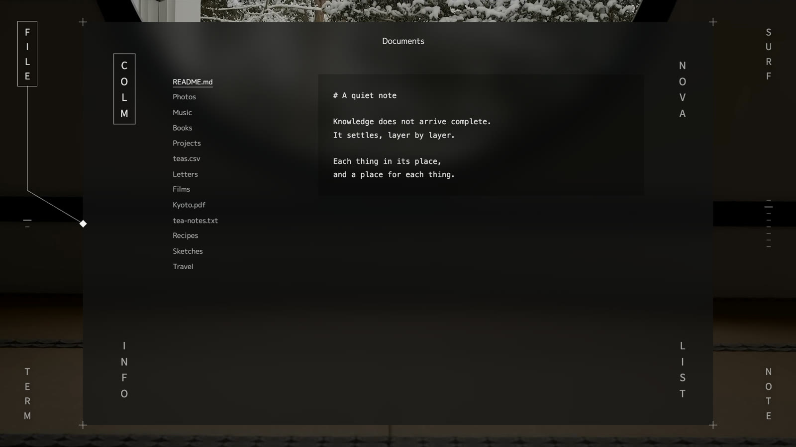
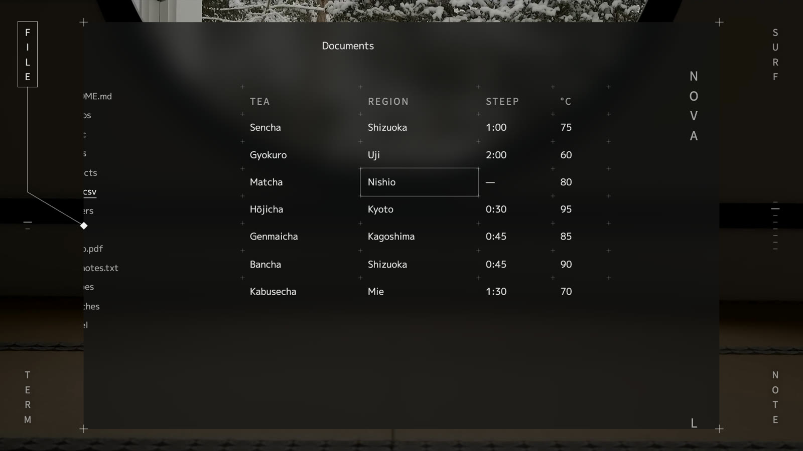
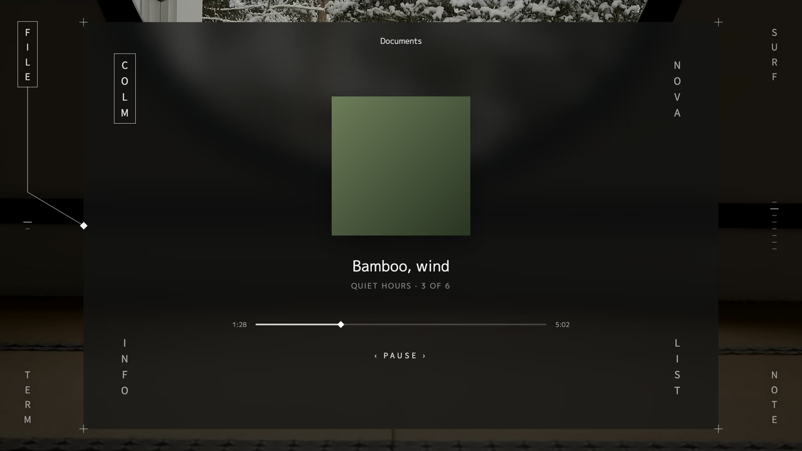

<div align="center">
  
  <h1>re: file</h1>
  <p><em>A place for everything</em></p>
  <p>Files, and what is in them: one quiet window for all of it.</p>
  <p><a href="https://getrespace.app/download/ReSpace.dmg">Download for Mac</a> · <a href="https://getrespace.app">getrespace.app</a> · <a href="https://ko-fi.com/artursavytskyi">Support</a></p>
</div>

**re: file** is a file manager that opens what it finds. Folders come in columns or as one list; a text is written in where it lies, a CSV becomes a table; pictures, PDFs, comics and books are read in the same window, and your music and the radio play from it. Nothing opens somewhere else.

<p align="center">
  <a href="https://getrespace.app">
    
  </a>
</p>

<details>
  <summary>📸 More pictures</summary>

| A CSV as a table | The player |
| --- | --- |
|  |  |

</details>

## What it does

- **Columns and lists**: Folders side by side, or one list with sizes and dates.
- **Texts**: A text opened is written in where it lies.
- **Books and pictures**: Pictures, PDFs, comics (CBZ, CBR) and EPUBs, page by page; manga right to left.
- **Tables**: A CSV as a table: cells written in, sorted, rows and columns added, copied to Numbers and back.
- **Music and radio**: Your library and internet radio, in the same window; shuffle, repeat, a queue, a mini player.

## Part of re: space

re: file is one of five quiet apps for the Mac. Each is fine alone; all five together make one quiet desk.

| | App | |
| :---: | :--- | :--- |
|  | [**re: desk**](https://github.com/artyr1997/ReDesk) | the desk they live on |
|  | [**re: file**](https://github.com/artyr1997/ReFile) *(this one)* | files, and what is in them |
|  | [**re: surf**](https://github.com/artyr1997/ReSurf) | a browser that stays out of the way |
|  | [**re: term**](https://github.com/artyr1997/ReTerm) | a terminal that reads like a conversation |
|  | [**re: note**](https://github.com/artyr1997/ReNote) | notes, in four quiet rooms |

## Install

Download **[ReSpace.dmg](https://getrespace.app/download/ReSpace.dmg)** from [getrespace.app](https://getrespace.app): all five apps, signed and notarized by Apple, so they open without a warning. Open it and drag each app into **Applications**.

Native Swift and AppKit. Runs on **macOS 13 Ventura or later**, on Apple silicon and Intel (one universal app).

## Keys

**General**

| Key | Does |
| :--- | :--- |
| ⇧↩ | everything inside, at once |
| ⌘N | new window |
| ↑ / ↓ | select |
| → / ↩ | open |
| ← | the folder above |
| / | search |
| C / L | columns / list |
| ⌃⌘1 – 4 | sort: name, kind, date, size |
| N | new folder |
| I | info |
| ⌫ | move to the Trash |

**Play**

| Key | Does |
| :--- | :--- |
| 1 / 2 / 3 | folder / songs / radio |
| Space | play / pause |
| S / R | shuffle / repeat |
| Q | queue |
| K | keep a station |
| M | mini player |

**View**

| Key | Does |
| :--- | :--- |
| ← → Space | turn the page |
| M | manga |
| F | full screen |

**Table**

| Key | Does |
| :--- | :--- |
| ↩ | write in a cell |
| ⇧ arrows, ⌘A | choose more cells |
| ⌘C / ⌘X / ⌘V | copy / cut / paste |
| ⇧⌘ arrows | add a column / row |
| ⌘⌫ / ⇧⌘⌫ | delete the row / column |
| ⌃⇧↓ / ⌃⇧↑ | sort by the column |
| ⌘Z / ⇧⌘Z | undo / redo |

With [re: desk](https://github.com/artyr1997/ReDesk) running, every key here can be set to your own in its keys sheet (⌘/).

## Build from source

With Xcode's command-line tools (Swift 5.9 or later) on macOS 13 or later:

```bash
./build.sh             # build/ReFile.app, universal (arm64 + x86_64)
./build.sh --install   # and into Applications
```

`build/ReFile.app/Contents/MacOS/ReFile --render <folder>` draws its views into pictures, from made-up data.

How it is made, in detail: [docs/DETAILS.md](docs/DETAILS.md).

## Support

re: space is made by one person, slowly and with care. If it makes your days a little calmer, you can [buy me a coffee on Ko-fi](https://ko-fi.com/artursavytskyi).

## License

[MIT](LICENSE) © 2026 Artur Savytskyi. Security reports: see [SECURITY.md](SECURITY.md).
